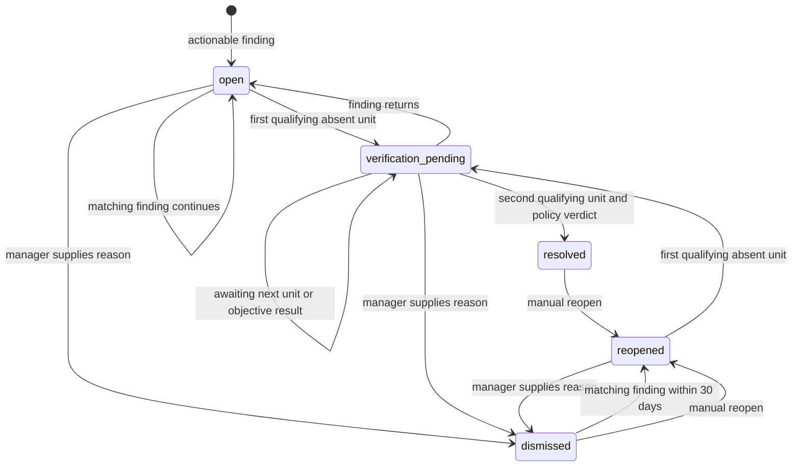

# Investigation system review

> Historical review, before the follow-up fixes. See the [implementation report](investigation-implementation.md) and [updated workflow map](investigation-flow-v2.html) for the current behavior.

Reviewed 2026-09-28 against the current working tree, including existing uncommitted changes. This is an end-to-end implementation review, not a comparison against a particular issue or commit. Application code was not changed during this review.

The system has a strong separation between measured evidence, AI-written advice, human actions, and case resolution. Its main weaknesses are at lifecycle boundaries: absence can be mistaken for recovery, and mutable action targets can become inconsistent with recorded outcomes. These issues should be addressed before relying on automated closure as proof of business recovery.

[Open the interactive workflow map](investigation-flow.html). The map is a component-level overview; the exact ordering and exceptions are below.

## Findings, in priority order

### R1 — High: manually saved cases can automatically recover without remeasurement

**Evidence:** `backend/app/main.py:434`, `case_engine.py:973`, `case_engine.py:1001`, `case_engine.py:543`; automatic stock-count detector at `mcp_server/tools/state_findings.py:570`.

The manual stock-count route generates a metric ID containing the outlet and date range. The daily detector emits the generic `completed_stock_count_variance` ID. Consequently, a manual case is never present in the daily scan's `seen_keys`. `sync_cases()` checks every active case, treats this absence as a clean snapshot observation, and closes it after two fresh scan dates.

**Reproduced:** save a scoped manual case, run two empty daily syncs on subsequent dates, and observe `resolved / recovered` without any query rechecking its stock-count scope.

**Fix direction:** record the case's detector/scope and require a successful explicit remeasurement before advancing verification. Cases with no recurring detector should require a suitable manual verification workflow. Also put `save_ad_hoc_case()` under the shared case-write lock: this API mutation currently bypasses the lock used by scans and other case mutations, allowing interleaving between matching, observation writes, and verification. The closure defect was reproduced; this concurrency risk was established by code inspection, not a stress test.

### R2 — High: editing a target retains its obsolete outcome

**Evidence:** `backend/app/services/finding_actions.py:151` and its upsert at `:244`; `action_outcomes.py:158` selects only unmeasured/inconclusive actions.

The upsert updates target fields but leaves `outcome_checked_at`, value, period, verdict, status, and confidence intact. A terminal action is then excluded from remeasurement.

**Reproduced:** an action with target revenue `>=100` measures `150` and gets `met`. Change its target to `>=200` and rerun outcome checks: it still displays `met`, value `150`, target `200`.

**Fix direction:** make measured target versions immutable, or invalidate and audit the outcome whenever its measurement inputs change. Reopening and completing an action again also needs an explicit policy: `completed_at` currently preserves the first completion even when status returns to `in_progress`.

### R3 — High: an unrelated action can become a case's objective

**Evidence:** `backend/app/services/case_engine.py:785`.

`designate_case_objective_from_action()` checks that the case and action exist and that the action has a target. It does not verify that the action belongs to that case. `OpportunityPolicy` subsequently trusts the designated action's outcome.

**Reproduced:** a snapshot opportunity accepted an action with no link to it, and its policy returned `captured` based on that unrelated action. This also bypasses the snapshot restriction applied to directly declared objectives.

**Fix direction:** require the action's `case_id` to match, validate its relevance and measurement compatibility, and reject foreign or unlinked actions before storing the designation.

### R4 — High: unavailable data can count as fresh recovery evidence

**Evidence:** `backend/app/services/brain.py:145`, `:255`; `case_engine.py:543`; `state_tracking.py:91`.

`_data_freshness()` returns `unavailable` if there is no latest order, but the caller passes `status != 'stale'` to case synchronization. Thus unavailable data is explicitly treated as fresh. Several snapshot detectors return no finding for empty input; absent cases can advance toward recovery. The older state tracker resolves an absent finding immediately, before the freshness check is computed.

**Verification:** source inspection and a probe of the exact Boolean expression, not a live data-loss experiment. Raised exceptions generally abort before case sync; successful empty responses remain ambiguous.

**Fix direction:** require `status == 'fresh'`, and track successful measurement/coverage separately for each detector. Fresh orders cannot prove that inventory or supplier inputs were successfully refreshed. Apply that coverage contract to all three tracking paths, not only persistent cases.

### R5 — Medium: anomalies starting from zero are missed

**Evidence:** `mcp_server/tools/intelligence.py:835`.

When all baseline values are zero, both percentage change and z-score become `None`. Neither significance test fires, regardless of the new value.

**Reproduced:** complete observations `[0, 0, 10]` for a `higher_is_bad` metric return `category='normal'`.

**Fix direction:** add an explicit zero-baseline rule using metric-specific absolute magnitude and exposure/minimum-volume requirements. Do not label every tiny nonzero value critical.

### R6 — Medium: AI output is not validated at the item level

**Evidence:** `mcp_server/tools/investigation.py:222`; `incident_engine.py:264`; rendering at `frontend/src/routes/CaseDetail.jsx:872`.

The recommendation parser checks only that the response is a JSON list. Lists containing nulls, strings, missing fields, or invalid priorities can enter persistent snapshots. Consumers expect recommendation objects. Prompt instructions do not enforce this contract.

**Verification:** code inspection; no malformed live provider response was requested.

**Fix direction:** validate each item with a strict model, bound list length and text sizes, and retain a visible/logged generation status when enrichment is rejected. Deterministic findings should still publish.

## How it works

### Entry points and storage

| Entry point | Behavior |
|---|---|
| Scheduler, `main.py:64` | Runs at 05:00 in `APP_TIMEZONE` (default Asia/Colombo), unless disabled. |
| `GET /investigations` | Requests the same scan pipeline with a forced refresh. |
| `GET /brief` | Uses the cached brief; missing or 24-hour-old cache triggers a scan. |
| `GET /intelligence/investigate/{metric_id}` | Returns a cached supplementary metric investigation; does not itself create a persistent case. |
| Ask Celeste | `agent.py` runs an AI tool-calling loop over available analytical tools. This is separate from automatic case detection. |
| Save stock-count investigation | Recomputes the requested scope on the server and explicitly saves a persistent case. |

Reporting data supplies analytical measurements. Separate application storage (`appdb`, configured with `APP_DATABASE_URL`) holds cases, observations, actions, tracking, and cached briefs. The documented sales/operations scope is Celeste's five outlet IDs, not warehouse identity or storefront name patterns; see ADR-0001. This review traced that shared scope contract but did not independently audit every underlying SQL query or reporting view.

`brain.run_daily_scan()` holds a shared file lock for the scan. A waiting request can reuse a scan that completed while it waited. Fresh cached reads can bypass that lock once schema initialization is complete.

### Exact scan order

`backend/app/services/brain.py:186` orchestrates:

1. Read the previous brief for notification comparison.
2. Scan all registered monthly metrics in parallel. For each actionable result: build breakdowns, impact, evidence, recommendations, and priority.
3. Add deterministic cross-metric corroboration after all monthly investigations exist.
4. Optionally generate one cross-finding AI synthesis when at least two findings have qualifying independent corroboration.
5. Build inventory, operational, data-control, and store/product/hour incident findings. Incident findings can make their own AI recommendation calls.
6. Record/check state tracking.
7. Scan the two short-term metrics; update weekly streaks and their outcomes.
8. Diff new critical findings against the prior brief; calculate order-data freshness.
9. Measure completed action targets before evaluating case resolution.
10. Synchronize all findings into cases and advance verification for unmatched active cases.
11. Record/check monthly finding tracking, calculate health and customer prediction summaries.
12. Insert the resulting brief into the cache.

The diagram compresses these operations. Ordinary snapshot findings do not pass through the monthly recommendation function; incident findings have a separate AI enrichment path. Action measurement shown after a manager decision occurs in a later scan, before that scan's case synchronization.

### Four detection families

| Family | Input and rule | Identity / output |
|---|---|---|
| Monthly trend | Latest complete month versus the mean of preceding complete trend rows. Significant if absolute relative change is at least 15% **or** absolute z-score is at least 1.5. Metric direction determines problem versus opportunity. | Finding ID `metric-period`; horizon `monthly`. |
| Short-term trend | Trailing seven-day windows anchored to the data's own latest timestamp. Same anomaly function. Currently cancellation rate and delayed-delivery rate only. | Finding ID `metric-trailing-as_of_date`; horizon `weekly`. |
| Snapshot rules | Threshold-based stock availability, dead/overstock, stuck counts, completed count variance, top-seller stock, outlet inactivity, negative stock, and cost-coverage checks. | Current-state finding; horizon `snapshot`. |
| Local incidents | Fourteen-day outlet × product × hour cancellation analysis. Score combines hourly z-score, basket lift, square root of exposure, and persistence. Candidates below 15 are not emitted as cases; 5–15 is a logged watchlist band. | Scope is encoded in the metric ID; joined to snapshot findings. |

The registry currently includes cancellation rate, revenue, order volume, delayed delivery rate, Uber failure rate, PickMe cancellation rate, customer retention, gross margin, average order value, supplier fill rate, purchase price variance, and supplier concentration.

`get_trend()` treats the latest available monthly row as partial even if the wall clock is later. This conservatively avoids treating a stale last row as complete. Rate values are numerator/denominator ×100; zero denominators currently become zero. There is no seasonality model or calibrated probabilistic detector here.

Priority for trend problems uses relative-change magnitude: 40%+ critical, 25%+ high, otherwise medium. Z-score priority bands are used only if percentage change is unavailable. Opportunities receive `worth_pursuing`. The business impact score multiplies severity by persistence, the presence of quantified impact, and a data-confidence adjustment. It does **not** rank directly by rupee amount.

### Evidence, impact, and AI

`intelligence.py` computes breakdowns; `evidence_engine.py` evaluates what they support; `impact_engine.py` computes available impact translations; `investigation.py` assembles the presentation object.

Important distinctions:

- The headline compares against a historical mean. Monthly breakdowns compare against the immediately preceding month. Evidence text explicitly names that comparison; the two baselines are not interchangeable.
- Concentration checks use additive contributions and a 60% threshold across up to three contributors. Outlet rate changes and composition shares cannot simply be added as total contribution.
- Evidence verdicts distinguish `confirmed`, `possible_contributor`, `related_not_independent`, `no_evidence_found`, and `unknown`. Confirmation of concentration is not proof of every operational mechanism.
- Cross-metric evidence checks independence and expected direction. Revenue and order volume sharing the same order data are not automatically independent corroboration.
- Monthly revenue impact is a measured difference. Order and cancellation translations use estimated monetary exposure. Unsupported translations and weekly impact return `None` rather than inventing rupee values.
- Monthly findings can retrieve prior recommendations, recorded actions, and observed outcomes as memory. Weekly evidence deliberately omits this monthly memory lookup.
- AI recommendations are optional, non-agentic calls with 45-second timeout and no SDK retries. Generation failure falls back to an empty list; synthesis failure to `None`.
- Per-metric recommendations are generated **before** cross-metric corroboration. They therefore do not see the second-pass corroboration added later. Only the daily synthesis sees that final cross-metric set.

The configured `.env` model is `moonshotai/kimi-k3`. An inconsistency remains from the earlier model change: `agent.py` defaults to Kimi, but `investigation.py:109` still defaults to Nemotron when `OPENAI_MODEL` is absent. The present explicit environment setting overrides both. This review did not modify that fallback or test live Kimi response quality. The sample's `reasoning_effort='max'`, streaming, and 16,384-token limit are not configured by the existing recommendation calls.

### Finding, case, action, and outcome are different records

| Record | Purpose |
|---|---|
| Finding | A detector's evidence for one period or snapshot. Carries ID, metric, domain, horizon, category, priority, confirmation, breakdowns, evidence, impact, and recommendations. Shapes vary by detector. |
| `business_cases` | Persistent business issue keyed for active matching by `(metric_id, domain, horizon)`. Segment names are evidence, not additional split keys. |
| `case_observations` | Latest snapshot for each case and scan date. Same-day rescans overwrite that day's row and increment its revision. This is not an immutable log of every scan. |
| `case_history` | Audit events, including immutable evidence captured when an action decision is saved. |
| `case_relationships` | Links such as `recurrence_of`. |
| `finding_actions` | One upserted operational action per finding ID: relevance, status, owner, deadline, action text, target, and outcome fields. A case can accumulate actions across findings. |
| Tracking tables | Separate monthly finding observations, state outcomes, and weekly streaks. These do not define persistent case resolution. |
| `daily_brief` | Published scan payload and its generation time. |

### Case lifecycle

A matching finding after a verified resolution creates a new case, linked as a recurrence when the prior closure is within the 30-day lookup window. A dismissed case that matches within that window reopens the same case.

For monthly cases, a verification unit is a different complete metric month. For weekly and snapshot cases, it is a new scan **date**, provided the supplied freshness flag passes. Therefore a weekly case can close after two daily checks; it does not wait for two independent, non-overlapping seven-day windows. Repeated checks in the same unit do not advance progress. The implementation counts distinct observed units; it does not enforce that calendar units are contiguous when scans are missed.

Problem recovery returns `recovered` after verification. Opportunity resolution checks an explicitly designated action, a direct objective, or relevant action targets. It can return `captured`, `expired`, `inconclusive`, or hold while measurement is pending. Completing an action alone never closes the case.

### Manager workflow and outcome measurement

The Investigate page lists cases with server-side status/domain/priority/metric filters and sorting. Search and type filters operate only on the loaded page. Case detail combines the latest observation, trend/evidence, relationships, history, actions, and resolution policy.

Accepting a recommendation records approval history; it does not create an operational action. Recording an action uses `not_started`, `in_progress`, or `completed`. Targets reference registered metrics, comparison operators, units derived on the server, and monthly or supported weekly cadence.

Case-detail saves send an evidence version. Under a shared lock, the server checks it and writes the action plus decision-evidence snapshot in one database transaction. Legacy callers may omit the version and are explicitly marked unverified. Lock contention returns a retryable conflict rather than saving against a moving scan.

Monthly action measurement waits for the first complete calendar month after completion. Weekly measurement chooses an available clean trailing window starting at or after the completion date. Targets can be absolute or relative to a recorded baseline. Results are `met` or `not_met`; missing data progresses through `pending`, `blocked`, and `inconclusive`. Late data can still replace an inconclusive result. Overlapping actions on a case lower attribution confidence; a met target does not establish that one action caused the improvement.

## Additional design limitations

- The scan lock covers optional AI calls, including up to ten sequential incident recommendation calls. Individual request timeouts do not impose one total scan deadline. Action saves wait only eight seconds for that lock.
- Scan publication is not a single transaction: tracking, outcomes, cases, health, and predictions can be written before the final brief insert. A late failure can leave newer state alongside an older cached brief. Serialization prevents simultaneous scans, not partial commits.
- Category can change while retaining case identity. `_touch_case()` updates category but not the stored `resolution_policy` name; resolution uses the current category while case detail returns the stored policy label. This can misdescribe the applied policy.
- Missing detector output carries no explicit distinction between healthy, unavailable, insufficient history, and out-of-scope. R1 and R4 are consequences of this shared contract gap.
- Changing AI model does not invalidate a fresh cached brief. Existing recommendations persist until a scan refreshes them.

## Validation and limits

**270 existing tests passed** across case engine/API, resolution policies, actions, concurrency/Phase 2e, scan pipeline/timeouts, evidence, root causes, related signals, impact, investigation confirmation, tracking, streaks, and synthesis. The run emitted 648 deprecation warnings (primarily naive UTC calls and FastAPI startup/shutdown hooks).

[Reproduction script](investigation-probes.py) uses temporary SQLite and mocked trend/date inputs. It confirms R1, R2, R3, and R5 and demonstrates R4's Boolean gate. Its assertions characterize defects; they are not acceptance tests for correct behavior.

No live reporting-data scan, provider call, production-state mutation, forecast calibration, or comprehensive browser interaction test of the application was performed. Existing passing tests do not establish that the identified gaps are safe.

Suggested repair sequence: establish detector coverage/reverification contracts (R1/R4), version action targets and validate objective ownership (R2/R3), then address zero-baseline detection and AI output validation (R5/R6). Add focused regression tests at each repaired boundary.

## Diagram receipt

- Type: workflow; specification: `investigation-flow.json`; output: `investigation-flow.html`.
- Validation: 9/9 showcase checks, zero composition errors or warnings.
- Specification: 4,467 bytes; SHA-256 `af56358d4a28d190dd5647aa10579fe79193f4e8e99366a39899ecaa17fad0e3`.
- HTML: 812,368 bytes; SHA-256 `0977e0f9f8b8b77e140acbdd3ec9a5f7d85539ea6b76082812086005b54405d1`.
- Automated browser evidence: passed at 1440×900, 1600×1000, 1920×1080, and 2048×1320; no horizontal or vertical overflow. Receipt: `investigation-flow.visual-check.json`.
- Perceptual review: inspected light 2048×1320 and dark 1440×900 screenshots; readable labels and clear routes, no observed overlap. This screenshot review does not certify every interactive control or export format.
